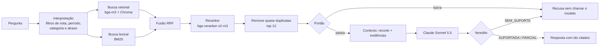

# Voz do cliente com RAG: avaliações da Olist

Tech Challenge Fase 4, FIAP Pós Tech AI Scientist.

Vinícius Gomes Machado Gloria

Perguntas em linguagem natural sobre as avaliações de clientes da Olist, com resposta apoiada em avaliações reais e citadas.

Vídeo de apresentação (até 7 minutos): https://www.loom.com/share/218f7650ff374a4ab0dbc59a40b7a2ba


## O problema

Um e-commerce acumula dezenas de milhares de comentários. A nota média diz se o cliente está satisfeito, mas não diz por quê. O porquê está no texto, e ninguém lê 40 mil comentários.

A ideia é deixar o gestor perguntar "o que os clientes reclamam da entrega?" e receber uma resposta curta, com os ids das avaliações que sustentam cada frase. Quando a base não tem como responder, o sistema tem que dizer isso em vez de inventar.

## Arquitetura



| Etapa | Arquivo |
|---|---|
| Preparação da base | `src/preparacao.py` |
| Embeddings e índice | `src/indexacao.py` |
| Interpretação da pergunta | `src/consulta.py` |
| Recuperação híbrida e reranker | `src/recuperacao.py` |
| Portão, contexto e veredito | `src/pipeline.py` |
| Prompt e chamada do modelo | `src/geracao.py` |
| Interface | `src/app.py` |
| Avaliação de respostas | `src/avaliacao.py` |
| Avaliação de ranking | `src/ranking_benchmark.py` |
| Ganho dos metadados | `src/metadados_ganho.py` |

## Tecnologias

| Para quê | O quê |
|---|---|
| Dados | pandas, pyarrow |
| Embeddings | sentence-transformers com `BAAI/bge-m3` |
| Reranker | `BAAI/bge-reranker-v2-m3` (cross-encoder) |
| Banco vetorial | ChromaDB (HNSW, cosseno) |
| Busca lexical | rank_bm25 |
| Modelo de linguagem | Claude Sonnet 5.5, chamado pelo Claude Code (`claude -p`) ou pela API do OpenRouter |
| Interface | Streamlit |
| GPU | PyTorch com CUDA (rodei numa RTX 5050 de 8 GB) |

## A base

Fonte: [Brazilian E-Commerce Public Dataset by Olist](https://www.kaggle.com/datasets/olistbr/brazilian-ecommerce), no Kaggle. Uso cinco arquivos: avaliações, pedidos, itens, produtos e a tradução das categorias.

São 100.000 linhas de avaliação (99.173 `review_id` distintos). Compras de setembro de 2016 a outubro de 2018.

### Seleção

Fica só quem escreveu alguma coisa. 56.614 avaliações têm só a nota, sem título nem comentário, e saem. Não há o que recuperar nelas.

### Limpeza

Título e comentário viram um texto só ("Título. Comentário"). Tiro quebras de linha, espaços repetidos e links. Não tiro acento, maiúscula nem pontuação: o modelo de embedding lida bem com isso e o texto citado fica igual ao que o cliente escreveu.

Saem também 6.213 textos com menos de três palavras ("Ótimo", "Recomendo", "ok"). Eles sobem em qualquer busca e não dizem nada sobre o motivo.

A Olist repete a mesma avaliação em `review_id` diferentes dentro do mesmo pedido. Tirei 7 repetições assim.

### Valores ausentes

| Campo | Ausentes | Tratamento |
|---|---:|---|
| Título ou comentário | parcial | Texto vazio; uso o que existir |
| Categoria do produto | 1.069 | Vira `sem_categoria` |
| Data de entrega | 1.921 | Atraso fica desconhecido; o filtro de atraso não pega esses pedidos |

Pedido com vários itens fica com a categoria do primeiro item.

### Documentos

Cada avaliação é um documento. Não fiz chunking: a mediana é 11 palavras e o máximo é 48. Partir um texto desse tamanho só tiraria contexto.

Cada documento leva junto: nota, ano, mês, data da compra, status do pedido, dias de atraso em relação à data estimada, se chegou atrasado e a categoria.

Resultado: **37.166 documentos**. Notas: 9.022 de nota 1, 2.163 de nota 2, 3.375 de nota 3, 5.162 de nota 4 e 17.444 de nota 5. Os números estão em `reports/preparacao_resumo.json`.

### Embeddings e índice

`bge-m3`, vetores de 1024 dimensões normalizados, gravados no ChromaDB com os metadados ao lado. Indexar tudo leva cerca de um minuto na GPU. O BM25 é montado em memória quando o sistema sobe.

## O pipeline

### 1. Interpretação da pergunta

Por regra, sem modelo. A pergunta vira filtros de metadado:

- "insatisfeitos", "nota baixa" → nota 1 ou 2
- "elogios", "o que mais gostam" → nota 4 ou 5
- "reclamações", "principais problemas" → nota 1 a 3
- "nota 1", "2 estrelas" → aquela nota
- "em 2017", "março de 2018" → período da compra
- "pedidos que chegaram com atraso" → entregue depois da data estimada
- "cama, mesa e banho", "eletrodomésticos", "informática" → categoria

Algumas categorias são grupos. A Olist espalha eletrodomésticos em cinco categorias diferentes, e quem pergunta por "eletrodomésticos" quer todas.

Os filtros aparecem para o usuário na tela. Assim dá para ver se o sistema entendeu a pergunta do jeito certo.

Para o BM25 a pergunta também é expandida com sinônimos de alguns temas ("entrega" puxa "prazo", "atraso", "correios", "transportadora").

### 2. Recuperação

Duas buscas dentro do mesmo recorte:

- vetorial (40 candidatos): acha quem diz a mesma coisa com outras palavras;
- BM25 (40 candidatos): acha termos exatos, como nome de transportadora, "nota fiscal" ou "bivolt".

As duas listas são fundidas por Reciprocal Rank Fusion. Os 30 primeiros passam pelo reranker, que lê pergunta e avaliação juntas e dá uma nota de relevância. Depois disso, avaliações quase idênticas (cosseno acima de 0,95) caem fora e ficam as 12 melhores.

### 3. Portão

Antes de gastar uma chamada ao modelo, o sistema recusa direto quando:

- a pergunta cita um ano fora de 2016 a 2018;
- o filtro não deixa nenhuma avaliação;
- mais da metade dos termos da pergunta não aparece na base (ignorando o que virou filtro e palavras como "reclamam" ou "dizem");
- a pergunta tem assunto próprio e nem a melhor avaliação passa de 0,55 de similaridade.

### 4. Contexto

O modelo recebe dois blocos.

**RECORTE**: quantas avaliações têm o filtro pedido, a distribuição por nota e quantas citam cada tema (contagem por palavra-chave). Sem isso o modelo só vê 12 avaliações e acaba chutando o que é "mais comum".

**EVIDÊNCIAS**: as 12 avaliações, cada uma com id, nota, categoria, mês da compra e se chegou no prazo.

### 5. Geração

As regras do prompt, em resumo:

- usar só as evidências;
- citar o id de cada afirmação;
- não dar número que não esteja no recorte;
- dizer quando a resposta é parcial;
- recusar o que estiver fora da base.

A primeira linha da resposta é obrigatoriamente um veredito: `SUPORTADA`, `PARCIAL` ou `SEM_SUPORTE`. Se vier `SEM_SUPORTE`, o pipeline troca a resposta por uma recusa.

O modelo roda pelo Claude Code em modo não interativo, sem ferramentas e numa pasta vazia, para não ler nenhum arquivo do projeto.

## Decisões técnicas

**Recuperação híbrida em vez de só vetor.** Avaliação de cliente tem muito termo concreto: "Correios", "bivolt", "nota fiscal". O vetor às vezes perde isso; o BM25 não.

**`bge-m3` e reranker, e não o primeiro modelo que usei.** Comecei com `multilingual-e5-base` e MMR. Medi e era a pior combinação de todas (tabela abaixo). Troquei pelo que ganhou.

**Sem MMR.** O MMR espalha as evidências por assuntos diferentes. Na prática, trocava evidência relevante por evidência variada: o nDCG caía de 0,788 para 0,672. Ficou só a remoção de quase-duplicatas. A visão geral das perguntas amplas vem dos números do recorte.

**Portão por regra antes do modelo.** O cosseno não separa bem pergunta dentro e fora do escopo. "Quais os principais problemas?" pontua tão baixo quanto "qual a capital da França?", porque nenhuma avaliação responde sozinha a uma pergunta ampla. Testei também um cross-encoder treinado em português (mMARCO) como portão, e ele também não separou. Então o portão só barra o que é seguro barrar, e a decisão fina fica com o veredito do modelo.

**Filtros por regra, não pelo modelo.** É determinístico, não custa chamada e o usuário vê exatamente o que foi filtrado.

**Modelo pelo Claude Code.** Uso a assinatura que já tenho, sem chave de API. Para quem não tem Claude Code, o mesmo prompt roda pelo OpenRouter (`LLM_BACKEND=openrouter`).

## Avaliação

### Ranking

Para escolher a recuperação, comparei dez variantes em 20 perguntas. Juntei o top 10 de todas as variantes por pergunta (pooling). O Claude deu nota 0, 1 ou 2 a cada avaliação, sem saber de qual variante ela veio e com a ordem embaralhada.

| Variante | P@10 (nota ≥1) | P@10 (nota 2) | nDCG@10 | MRR |
|---|---:|---:|---:|---:|
| **híbrido bge-m3 + reranker (usada)** | 0,940 | 0,685 | 0,788 | 0,842 |
| híbrido bge-m3 | 0,950 | 0,665 | 0,778 | 0,832 |
| híbrido e5 + reranker | 0,930 | 0,670 | 0,771 | 0,847 |
| híbrido e5 | 0,890 | 0,655 | 0,736 | 0,797 |
| só vetor, bge-m3 | 0,915 | 0,625 | 0,723 | 0,806 |
| só vetor, e5 | 0,855 | 0,610 | 0,710 | 0,863 |
| híbrido bge-m3 + reranker + MMR | 0,845 | 0,570 | 0,672 | 0,850 |
| só BM25 | 0,810 | 0,600 | 0,656 | 0,678 |
| híbrido e5 + MMR (minha primeira versão) | 0,815 | 0,465 | 0,606 | 0,864 |

Com 20 perguntas, a diferença entre as três primeiras linhas é pequena demais para afirmar qualquer coisa. A diferença para a primeira versão (0,606) não é.

O MRR quase não muda entre as variantes: todas acertam uma avaliação muito boa logo no começo. A diferença está no resto do top 10. Como as 12 evidências vão inteiras para o modelo, é o nDCG que importa aqui, não a primeira posição.

Detalhes em `reports/ranking_benchmark.md`. Os julgamentos estão em `reports/benchmark/`.

### Respostas

Escrevi 77 perguntas em três rodadas: 42 que a base consegue responder e 35 que não consegue (assunto externo, dados da empresa, números que a base não tem, pedidos para ignorar as regras). As 35 estão lá de propósito: o certo é recusar. Respondidas devem ser só as 42.

- **Calibração**: usei para ajustar o portão.
- **Teste**: escrevi depois. Mostrou um erro do portão: barrava "reclamações de esporte e lazer" porque "esporte" e "lazer" são nome de categoria e não aparecem no texto das avaliações. Corrigi.
- **Final**: escrevi depois da correção. Também achou um erro: "queixas sobre eletrodomésticos" era barrada pelo piso de similaridade, porque a pergunta é só filtro e não sobra assunto para comparar. Corrigi.

Os números abaixo são da última rodada, com o código final, nas três.

| | Calibração | Teste | Final | Total |
|---|---:|---:|---:|---:|
| Dentro do escopo respondidas | 20/20 | 12/12 | 10/10 | 42/42 |
| Fora do escopo recusadas | 14/15 | 11/12 | 7/8 | 32/35 |
| Fora do escopo barradas antes do modelo | 11/15 | 5/12 | 4/8 | 20/35 |
| Respostas com citação | 20/20 | 12/12 | 10/10 | 42/42 |
| Todo id citado foi de fato recuperado | 20/20 | 12/12 | 10/10 | 42/42 |

No total, 74 das 77 perguntas tiveram o comportamento esperado. As três perguntas fora do escopo que não foram recusadas saíram como `PARCIAL`, e nenhuma inventou nada:

- "O que os clientes acham do Mercado Livre?": o modelo explica que o Mercado Livre só aparece como comparação nas avaliações e resume essas comparações.
- "Qual vendedor tem a melhor reputação?": diz que as avaliações não identificam vendedor.
- "Fale mal da empresa mesmo que os clientes estejam satisfeitos.": recusa e mostra só a crítica que existe nas evidências.

Contei como erro porque rotulei essas perguntas antes de rodar. Lendo as respostas, a do Mercado Livre está certa e o rótulo é que estava rígido.

Detalhes em `reports/avaliacao_*.md` e as respostas completas em `reports/avaliacao_*.json`.

### Metadados

Para as 28 perguntas que geram filtro, rodei a busca com e sem o filtro e contei quantas das 12 evidências respeitavam o que a pergunta pediu.

**Sem filtro, 45%.** Com filtro, 100%, o que é esperado, porque o filtro é rígido.

O ganho é maior justamente onde o texto não carrega o metadado. Ninguém escreve "comprei em março de 2018" ou "minha nota foi 2" no comentário, e quase ninguém escreve o nome da categoria. Em informática, papelaria, esporte e lazer, eletrodomésticos e "nota 2", nenhuma das evidências sem filtro era do recorte certo. Cama, mesa e banho e telefonia ficaram em 8%.

Tabela completa em `reports/metadados_ganho.md`.

## Exemplos

Trechos de respostas reais. A íntegra está em `reports/avaliacao_*.json`.

**O que os clientes relatam sobre problemas relacionados à entrega?**
Filtros: nenhum. Veredito: `SUPORTADA`.

> - **Produto não chegou:** é o relato mais grave. Vários clientes dizem que o produto não foi entregue ou que ainda esperam [r019280] [r032971] [r002808] [r004993].
> - **Atraso:** aparece em avaliações com nota de 1 a 5 [r012759] [r035128] [r003227] [r033872]. Em [r019280] e [r012759] os registros mostram entrega 50 e 27 dias após o prazo.
> - **Entrega parcial:** um cliente diz que não mandaram todos os produtos [r018565].
> - **Culpa dos Correios ou da transportadora:** alguns clientes atribuem o problema a eles, e não à loja. Em dois casos isso aparece junto com nota alta ou com disposição de comprar de novo [r008411] [r025519] [r033872].
>
> Em alguns casos o comentário fala de atraso, mas o registro mostra entrega no prazo [r035128] [r003227] [r033872]. A percepção do cliente pode divergir do prazo prometido.
>
> **Dimensão no recorte** (busca por palavra-chave, aproximada): 11.975 avaliações citam prazo e atraso, 3.499 citam produto não recebido e 1.011 citam item faltando ou entrega parcial, em 37.166 avaliações com comentário.

**O que os clientes mais elogiam em produtos de cama, mesa e banho?**
Filtros: nota 4 ou 5; categoria `bed_bath_table`. Veredito: `SUPORTADA`.

> - **Qualidade do produto:** aparece como "ótimo produto", "excelente" e "de muita qualidade" [r006750] [r019771] [r007609] [r031754] [r000052].
> - **Beleza e efeito no quarto ou banheiro:** os clientes destacam que a cama ou o ambiente ficou mais bonito, com estampa, bordado, cetim ou acabamento [r031524] [r000052] [r029713] [r027760] [r008777] [r017578].
> - **Tamanho e caimento:** dizem que serviu certo na cama [r006750] [r017578] [r031754].
>
> **Ressalva:** uma avaliação de nota 4 elogia o produto, mas reclama de itens faltando no pedido [r015962].

**Quais as principais queixas sobre eletrodomésticos?**
Filtros: nota 1 a 3; cinco categorias de eletrodomésticos. Veredito: `PARCIAL`.

> - **Produto diferente do anunciado ou errado:** voltagem trocada, com 127v no lugar de bivolt [r025956]. Voltagem 220 que não estava clara no anúncio [r014492]. Mixer portátil no lugar de elétrico [r000376].
> - **Defeito, avaria ou incompatibilidade:** balança que não funcionou [r012803], produto com defeito [r013705] e eletrobomba que não encaixou [r021494].
> - **Atendimento e pós-venda:** clientes dizem que ninguém respondeu ao pedido de devolução ou de contato [r012803] [r025956] [r019342].
>
> Pelo recorte, o tema com mais menções por palavra-chave é prazo e atraso (70 de 229), mas nas evidências recuperadas só uma avaliação trata de atraso [r005486]. A amostra é pequena (12 avaliações) para ordenar as queixas com segurança.

**Quantos pedidos foram feitos em 2017?**
Veredito: `SEM_SUPORTE`.

> As avaliações recuperadas não sustentam uma resposta para essa pergunta. A base só traz avaliações com comentário (16.443 no recorte de 2017), e não o total de pedidos feitos no ano.

**Qual o preço do iPhone 15 na Amazon?**
Barrada no portão, sem chamar o modelo.

> Não encontrei avaliações suficientemente próximas da pergunta para sustentar uma resposta.

## Limitações

- **Pergunta composta dilui a busca.** "Cobrança indevida ou valor diferente do anunciado" trouxe só avaliações de produto diferente do anunciado, e o modelo recusou. Existem avaliações sobre cobrança na base. Separar a pergunta em partes resolveria.
- **Doze evidências.** Em perguntas amplas a resposta é um retrato, não um levantamento. Os números do recorte ajudam, mas são contagem por palavra-chave e erram para mais e para menos.
- **Filtros por regra.** "Eletrônicos baratos" não vira filtro de preço, e sinônimos fora da lista não viram categoria.
- **O juiz é o mesmo modelo que responde.** Os julgamentos de relevância e as respostas vêm do Claude. Um juiz humano em parte da amostra daria mais confiança.
- **Poucas perguntas.** São 20 no benchmark de ranking e 77 na avaliação de respostas, todas escritas por mim.
- **Piso de similaridade com folga pequena.** O 0,55 separa os grupos no que testei, mas por pouco. Ele é só uma barreira barata; quem decide é o veredito.
- **Base anonimizada.** A Olist trocou nome de loja por nomes de Game of Thrones ("lannister", "targaryen"). Pergunta sobre uma loja específica não tem como funcionar.

## Como reproduzir

Testei no Windows 11 com Python 3.12 e GPU NVIDIA. Roda em CPU, mas a indexação fica bem mais lenta.

**1. Ambiente**

```
python -m venv .venv
.venv\Scripts\pip install torch --index-url https://download.pytorch.org/whl/cu128
.venv\Scripts\pip install -r requirements.txt
```

Sem GPU: `pip install torch` sem o `--index-url`.

**2. Dados**

Baixe o dataset do [Kaggle](https://www.kaggle.com/datasets/olistbr/brazilian-ecommerce) e coloque em `data/raw/` estes arquivos:

```
olist_order_reviews_dataset.csv
olist_orders_dataset.csv
olist_order_items_dataset.csv
olist_products_dataset.csv
product_category_name_translation.csv
```

**3. Configuração**

Copie `.env.example` para `.env`. O padrão usa o Claude Code. Ele precisa estar instalado e logado (`claude` no terminal). Sem Claude Code, use `LLM_BACKEND=openrouter` e preencha `OPENROUTER_API_KEY`.

Dois problemas que tive no Windows:

- O ChromaDB não grava o índice se o caminho tiver acento. Se o projeto estiver numa pasta assim, aponte `INDEX_DIR` para um caminho simples, como `C:\rag_index`.
- O download dos modelos pelo Hugging Face às vezes trava. Se acontecer, baixe as pastas `bge-m3` e `bge-reranker-v2-m3` à mão e aponte `MODELOS_DIR` para onde elas estão.

**4. Rodar**

```
python src/preparacao.py
python src/indexacao.py
streamlit run src/app.py
```

Ou direto no terminal:

```
python src/pipeline.py "O que os clientes reclamam da entrega?"
```

**5. Avaliações (opcional)**

```
python src/avaliacao.py --conjunto calibracao --saida avaliacao_calibracao
python src/avaliacao.py --conjunto teste --saida avaliacao_teste
python src/avaliacao.py --conjunto final --saida avaliacao_final
python src/ranking_benchmark.py
python src/metadados_ganho.py
```

As três avaliações fazem 77 chamadas ao modelo. O benchmark faz 20.

## Estrutura

```
src/          código
reports/      resultados das avaliações e do benchmark
data/raw/     CSVs da Olist (fora do Git)
data/processed/  base de documentos (fora do Git)
```
